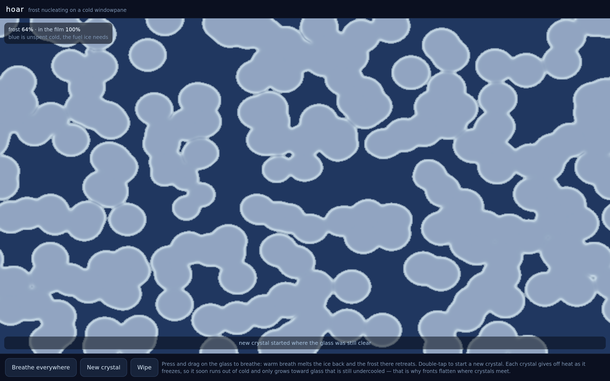
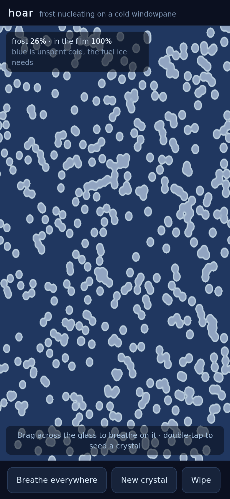

# hoar — breath on cold glass

<!-- Front page image: docs/desktop.png -->

A pane of cold glass with a thin film of water on it. Frost nucleates, grows, and
competes for the cold. You breathe on it to melt it back.



## What you are looking at

The pane is covered by a film of water a few micrometres thick. The glass is below
freezing, so the film is *undercooled* — it wants to freeze but needs somewhere to
start. That undercooling is the fuel, and it is what the blue haze shows: bright blue
is very cold liquid, dull blue is liquid the frost has already warmed.

Frost starts wherever a speck of ice appears. It grows outward into cold liquid, and it
stops where the liquid is no longer undercooled.

## What you can do

- **Press and drag on the glass** to breathe. Your breath is warm and wet: it melts the
  ice back and leaves a clear patch that refreezes from its edges once you stop.
- **Double-tap** (or double-click) to start a new crystal on clear glass.
- **New crystal** starts one on whatever clear glass remains, and tells you if there is
  none left.
- **Breathe everywhere** warms the whole pane at once.
- **Wipe** starts the pane over.

## The mechanism, honestly

Two fields drive everything: the phase `phi` (ice or liquid) and the undercooling `u`
(how much cold is left in the film).

```
tau dphi/dt = eps^2 div(a(n) grad phi) + (phi - phi^3) + 2*sqrt(2) (u - u_melt)(1 - phi^2)
du/dt       = D lap u + L dphi/dt - breath
```

The part worth watching is `L dphi/dt`: **freezing releases heat**. A crystal therefore
destroys the very cold that lets it grow, digging a hollow in the film around itself.
Two crystals growing toward each other run out of fuel in the ground between them, so
their fronts flatten and stop where they meet rather than overshooting. That is why real
hoar forms polygonal cells with straight shared edges, and it is the same mechanism as
recrystallisation in metals.

The blue haze dimming around each crystal is this effect made visible. Without it the
competition — the actual physics — would be invisible.

## What this model does and does not show

**Shown, and worth trusting:** growth from a seed into undercooled liquid; fronts that
flatten and halt where crystals meet; growth that stalls and reverses where the film is
warmed; latent heat released by freezing, which visibly slows later growth.

**Not shown:** the feathery, branched crystals you get on a very cold pane. Those are
dendrites, and they need the ice's crystal directions to matter at a scale finer than
this model's interface. I tried a full anisotropic phase-field implementation and could
not resolve dendritic sidebranching at a resolution a single-file browser app can afford
— at the cell counts that run at 60 fps the front grows as a smooth blob, not a fern.

So this app models *cellular* frost, and the shapes you get are the rounded, interlocking
cells of a fast-frozen pane rather than needles. The pattern in the screenshots is what
the equations actually produce, not a picture of frost with equations attached.



## Controls

| Input | Effect |
| --- | --- |
| Drag on the glass | Breathe: melt the frost back under your finger |
| Double-tap / double-click | Nucleate a crystal at that point |
| New crystal | Nucleate one on remaining clear glass |
| Breathe everywhere | Warm the whole film |
| Wipe | Reset the pane |

`frost` is the fraction of the pane covered by ice. `in the film` is the mean
undercooling remaining, as a percentage of the coldest the film gets.

## Running it

**▶ [Play it now](https://raw.githack.com/thaumapolis/hoar/main/index.html)** — no install, no network, nothing to build.

*About that link: it is served by [raw.githack.com](https://raw.githack.com), which
forwards the file straight from GitHub. Once it has loaded, the page makes no further
requests — the showcase's offline proof loads it in a browser, blocks every request the
page tries to make, and reports from inside that nothing was needed.*

Open `index.html` in a browser. It is one file with no dependencies: no network, no
build step needed to view it, no storage, and it works inside a sandboxed
opaque-origin iframe.

## Development

Source is modular in `src/` (`sim.js` physics, `app.js` interaction, `index.html`
shell); `tools/build.mjs` flattens it into `index.html`.

```console
$ nix develop          # node + playwright + browsers, pinned by flake.lock
$ ./check.sh
```

`check.sh` rebuilds first and refuses to test a stale artifact, then runs:

- `tests/rules.test.mjs` — the physics contract, headless: undercooling alone must not
  freeze the pane, seeds must grow monotonically, freezing must raise the film's heat,
  a warm region must halt growth, long runs must stay finite, and an unstable timestep
  must be rejected at construction.
- `tests/artifact.test.mjs` — drives the generated `index.html` in a browser: desktop,
  phone portrait and landscape, that the canvas is genuinely painted (not blank, not
  NaN-black), that wiping reduces frost, that breathing melts where it points, that
  onboarding appears before first use and disappears after, and that the file boots with
  no page errors in a sandboxed opaque-origin iframe with storage denied.

CI (`.github/workflows/ci.yml`) runs exactly `nix develop --command ./check.sh`, so local
and CI are the same command.

`nix build` produces just `index.html` and asserts at build time that it references no
external file and no web storage or network API.
